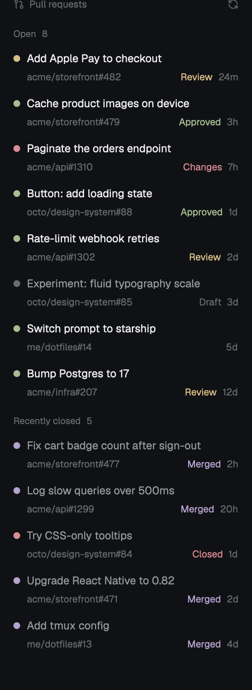

# Herdr PRs

A sidebar of your GitHub pull requests for the [Herdr](https://herdr.dev) desktop app: the 15 open ones with the latest activity, and the 5 you merged or closed most recently.



- **Open PRs at a glance.** A dot for CI (green passed, red failed, yellow running, grey no checks), the repo and number, the review state (Review, Approved, Changes, Draft) and how long ago it last changed.
- **Recently closed.** The last 5 merged (purple) or closed (red) PRs, with when they closed.
- **One click to GitHub.** Click a row to open the PR in your browser.
- **Stays current.** Refreshes every 2 minutes, or with the button in its header. If GitHub doesn't answer, the error shows above the last good list.

It's not meant to list everything: for that there's [github.com/pulls](https://github.com/pulls).

## Requirements

- [GitHub CLI](https://cli.github.com) (`gh`), logged in (`gh auth login`). The mod runs `gh api graphql` with your login; it sees what you can see, including private and internal repos.
- macOS, Linux (`xdg-open`) or Windows to open links.

## Install

**With your Herdr agent:** ask it to add this mod from `https://github.com/fbluemle/herdr-prs` and put it in your layout.

**By hand:** copy the mod into Herdr's home. Copy rather than symlink: Herdr doesn't notice changes inside a symlinked mod folder.

```sh
git clone https://github.com/fbluemle/herdr-prs.git
cp -R herdr-prs/mods/prs ~/.config/herdr-app/mods/
herdr-app check ~/.config/herdr-app/mods/prs
```

Then add it to a layout. Herdr's shipped layouts are read-only, so use one of yours, or clone one first (`herdr-app do layout.clone '{"name":"main","as":"my-main"}'`, which also switches to it). Add a block where you want the list, for example as the last child of the root row:

```json
{ "id": "prs", "type": "block", "size": { "px": 300 }, "min": 220, "max": 520,
  "background": "chrome", "content": { "mod": "prs" } }
```

and, if you like, a key in that layout's section of `keys.json`: `"cmd-shift-g": "layout.toggle:prs"`.

## Change it

The counts and the refresh interval are constants at the top of `mods/prs/main.js` (`OPEN_COUNT`, `CLOSED_COUNT`, `REFRESH_MS`). Herdr reloads the mod as soon as you save.

## License

MIT. The icons are from [Lucide](https://lucide.dev), ISC license, copyright Lucide Icons and Contributors.
