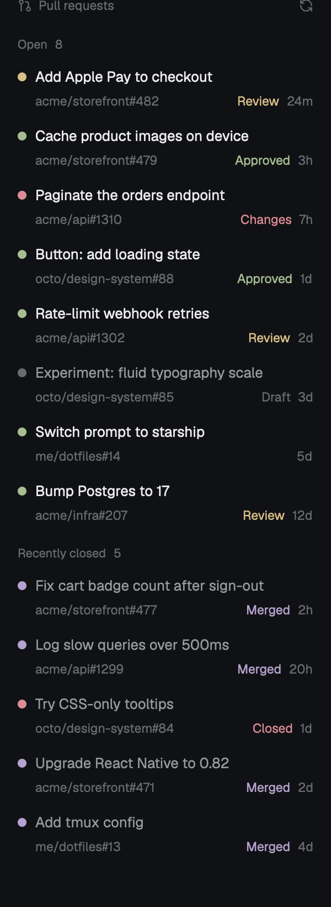

# Herdr PRs

A sidebar listing the person's own GitHub pull requests: the 15 open ones with the latest activity, each with its CI and review state, then the 5 most recently merged or closed. Clicking a row opens the PR in the browser.

## What you see

- **The block**: placed by the person's layout; built for a sidebar about 300px wide (220 to 520), background `chrome`, e.g. on the right of the window divided from the work area by the layout's 1px `border` divider.
- **Header**, 41px (14px top, 5px bottom padding, 16px sides): a 13px pull-request icon and "Pull requests" in `dim` 11.5px medium; at the right a 13px refresh icon in `dim` (`foreground` on hover), turning once every 900 ms while loading.
- **Section labels**, 11px medium `dim`: "Open 15", then "Recently closed 5", 10px above and 4px below, 8px in from the list.
- **A row**, two lines, 6px vertical padding, 6px rounded, `hover` background on hover:
  - Line 1: an 8px round dot, then the title in 13px `foreground`, truncated. Drafts and closed PRs have the title in `muted`.
  - Line 2, indented 16px, 11.5px `dim`: `owner/repo#number` (truncated), then a tag, then the age (`24m`, `3h`, `12d`).
- **Open PR dot = CI** of the last commit: `ansi2` (green) passed, `ansi1` (red) failed or error, `ansi3` (yellow) pending or expected, `dim` no checks.
- **Open PR tag = review**: Draft (`dim`), Approved (`ansi2`), Changes (`ansi1`, changes requested), Review (`ansi3`, review required); none otherwise. Age is since the last update.
- **Closed PR dot and tag**: Merged in `ansi5` (purple), Closed in `ansi1`. Age is since it closed.
- **Messages**, 12px: "Loading…" (`dim`) before the first answer; "No open pull requests." / "None yet." for empty sections; "Couldn't load PRs: …" in `ansi1` above the lists when a refresh fails.

## How it behaves

- Fetches on start, every 2 minutes and when the refresh icon is clicked; a fetch already running isn't started twice. Redraws once a minute so the ages stay right.
- A failed fetch keeps the last good lists and shows the error above them; the next good fetch clears it.
- Clicking a row opens the PR's URL: `open` on macOS, `xdg-open` on Linux, `cmd /c start "" <url>` on Windows (by `window().platform`).
- Hovering a row shows a tooltip with the full title and the CI or merge state.
- Showing and hiding is the layout's business: with the block's id `prs`, `layout.toggle:prs` bound in that layout's `keys.json` section does it.

## Built from

- **Mod** `mods/prs/`: `main.js`, `mod.json` (`{ "place": "none" }`: a layout places it), `git-pull-request.svg` and `refresh.svg` (drawn with `svg()` so they take the text color).
- **Data**: one `exec("gh", ["api", "graphql", "-f", "query=…"])` with two aliased searches:
  - `open`: `is:pr is:open author:@me archived:false sort:updated-desc`, first 15: number, title, url, isDraft, updatedAt, reviewDecision, repository.nameWithOwner, `commits(last: 1)` → `statusCheckRollup.state`.
  - `closed`: `is:pr is:closed author:@me sort:updated-desc`, first 20: number, title, url, state, closedAt, repository.nameWithOwner. Sorted by closedAt, the first 5 kept.
- **herdr**: `exec`, `theme`, `window` (platform). `cx.timer.every` for the refresh and age timers, `cx.spawn` for the fetch.
- **Placement** (not shipped; the person's own layout): e.g. one more child at the end of the root row of a clone of Herdr's `main`: `{ "id": "prs", "type": "block", "size": { "px": 300 }, "min": 220, "max": 520, "background": "chrome", "content": { "mod": "prs" } }`.

## Watch out

- The mod runs programs (`gh`, and `open` / `xdg-open` / `cmd`) and reaches the network through `gh`. It needs `gh` installed and logged in; without it the error shows in the block.
- GitHub search can't sort by close date. `updatedAt` is never before `closedAt`, so the most recently closed PRs are among the most recently updated: fetching 20 and sorting covers it unless more than 15 older closed PRs got activity since.
- The CI and review fields make the search slow (seconds) and GitHub sometimes answers with HTTP 502; more results make it worse. Keep the last good lists on screen rather than clearing them on error.
- A merged/closed state other than `MERGED` or `CLOSED` is an error, not a silent default.
- Herdr's shipped layouts are read-only: the block goes in a layout of the person's own (or a clone).
- Herdr doesn't reload a mod from a symlinked folder; install by copying.

## Done when

- `herdr-app check ~/.config/herdr-app/mods/prs` passes.
- With the block in the shown layout, it lists up to 15 open PRs, newest activity first, then up to 5 closed ones, newest close first, matching `gh search prs --author=@me --state=open --sort=updated`.
- A PR with failing checks has a red dot; an approved PR shows "Approved"; a draft shows "Draft" with a muted title; a merged PR shows a purple dot and "Merged".
- Clicking a row opens that PR in the browser.
- Clicking the refresh icon turns it until the updated list shows.
- With `gh` logged out (`gh auth logout`), the block shows "Couldn't load PRs: …" in red.
